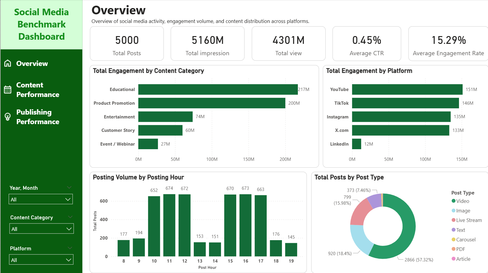

# 📊 Social Media Benchmark Analysis
A social media benchmark analysis project that identifies engagement trends across platforms, content categories, post types, and post hours to support data-driven content strategy recommendations.

## 🎯 Project Overview
This project uses social media data collected from multiple business accounts within the same industry as the target client. The analysis compares engagement performance across platforms, content categories, post types, and post hours to identify potential opportunities for improving the client's content strategy. The findings serve as benchmark-based recommendations for the client to test and validate against their own performance data.

## ❓Business Questions
- Which content categories and post types achieve higher average engagement rates across social media platforms?
- Which platforms offer the strongest engagement opportunities?
- Which posting hours are associated with higher engagement?

## 🗂️ Dataset 
The dataset contains social media posts collected from multiple business accounts operating in the same industry across Instagram, LinkedIn, TikTok, X (Twitter), and YouTube.

Dataset source: https://dataset.xomdata.com/datasets/social_media.posts

## 🛠️ Tools & Skills
- **Power BI:** Dashboard development, data modeling, interactive filtering, and data visualization.
- **Power Query:** Data cleaning, preparation, and transformation.
- **Data Analysis:** Descriptive analysis, KPI comparison, and engagement benchmarking across platforms and content types.
- **Business Communication:** Interpreting analytical findings and developing data-driven recommendations.

## 📈 Dashboard Preview

[]



## 🔍 Key Insights
**1. Customer Story and Educational Content Show Strong Average Engagement**

Customer Story and Educational content recorded average engagement rates of **19.96%** and **19.89%**, respectively.

Both categories show promising engagement potential, with no clear performance advantage for either category based on average engagement rate alone.

**2. Promising Post Types Differ Across Platforms**

Image posts recorded relatively high average engagement rates on Instagram and LinkedIn, while Video and Livestream content also showed promising engagement performance on TikTok and YouTube. This suggests that content format preferences may vary across platforms

**3. Posting Activity Is Concentrated in Certain Time Windows**

Posting activity was highest around **10:00–12:00** and **15:00–17:00**. However, average engagement rates varied relatively little across publishing hours, suggesting that these high-activity periods do not necessarily offer a clear engagement advantage.

## 💡 Recommendations
**1. Use Both Content Categories** Test both Customer Story and Educational content instead of focusing entirely on one category. Use Educational content to provide useful information and Customer Story content to showcase customer experiences, product applications, and real-world benefits.

**2. Choose Content Formats for Each Platform:** Prioritize Image posts on Instagram and LinkedIn, and develop Video and Livestream content for TikTok and YouTube.

**3. Diversify Posting Times:** Avoid concentrating posts in the 10:00–12:00 and 15:00–17:00 time windows solely because posting activity is highest during these periods. Keep these time windows in the current schedule while shifting some posts to other hours to explore opportunities for higher engagement.

## ⚠️ Limitations
- The dataset does not include follower counts or brand identifiers, limiting the ability to assess engagement relative to audience size or compare performance across individual brands.

## 📁 Project Structure
```text
social-media-benchmark-analysis/
├── README.md
├── dashboard/
│   └── Social Media Dashboard.pbix
└── screenshots/
    ├── overview.png
    ├── content-performance.png
    └── publishing-performance.png
