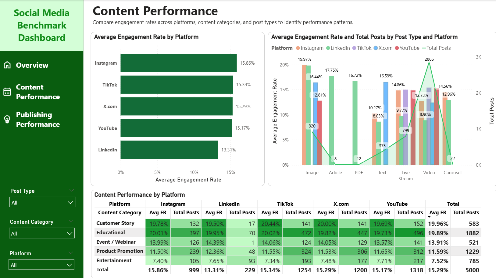
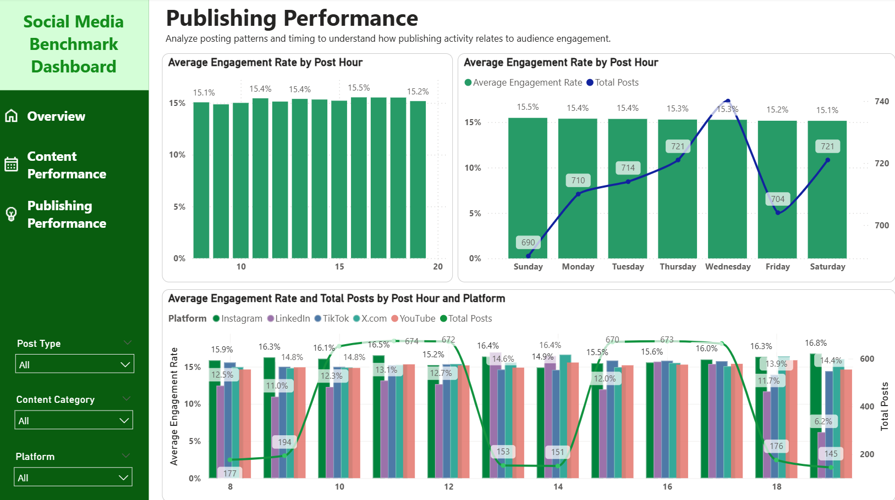

# 📊 Social Media Benchmark Analysis
A Power BI project analyzing social media engagement patterns across platforms, content categories, post formats, and publishing times to identify potential opportunities for content strategy optimization.

## 🎯 Project Overview
This project analyzes social media engagement benchmarks across multiple platforms, content categories, post types, and publishing hours. Using data collected from multiple business accounts within the same industry as the client, the analysis aims to identify engagement patterns and provide actionable, data-informed recommendations to help the client optimize its social media content strategy.

## ❓Business Questions
- Which content categories show stronger engagement in the analyzed social media data?
- Which content formats perform relatively well across different social media platforms?
- How does engagement rate vary across posting hours?
- Should publishing schedules be evaluated separately for each platform?

## 🗂️ Dataset 
The dataset contains social media posts collected from multiple business accounts operating in the same industry across Instagram, LinkedIn, TikTok, X (Twitter), and YouTube.

Dataset source: https://dataset.xomdata.com/datasets/social_media.posts

## 🛠️ Tools & Skills
- **Power BI:** Dashboard development, data modeling, interactive filtering, and data visualization.
- **Power Query:** Data preparation and transformation.
- **Data Analysis:** KPI comparison, descriptive analysis, and performance benchmarking.
- **Business Communication:** Translating analytical findings into actionable recommendations.

## 📈 Dashboard Preview
### 1. Overview
Provides a high-level summary of social media activity and engagement performance across platforms and content categories.


### 2. Content Performance
Compares engagement patterns across platforms, content categories, and post formats to identify promising content approaches.



### 3. Publishing Performance
Examines engagement rates and posting volume across publishing hours and days to explore potential timing patterns.



## 🔍 Key Insights
**1. Customer Story and Educational Content Show Strong Average Engagement**
Customer Story and Educational content recorded average engagement rates of 19.96% and 19.89%, respectively.
These categories are promising candidates for further testing. However, the small difference between their average engagement rates does not establish a meaningful performance advantage for either category.

**2. Promising Post Formats Differ Across Platforms**
Image posts recorded relatively high average engagement rates on Instagram (19.97%) and LinkedIn (19.83%). Other formats also showed promising patterns on specific platforms.
This suggests that content format should be evaluated in the context of each platform rather than applying one format recommendation across all channels.

**3. Publishing Volume Concentrates in Certain Time Windows**
Posting activity was concentrated around 10:00–12:00 and 15:00–17:00. However, average engagement rates varied relatively little across publishing hours.
Higher posting volume alone does not establish that a time window is more effective. Additional testing is needed to determine whether timing changes can improve engagement.

## 💡 Recommendations
- **Test promising content categories:** Develop controlled experiments using Customer Story and Educational content, then compare engagement performance against the existing content mix.
- **Adapt formats to each platform:** Test image, video, and other relevant formats by platform while keeping content topics and campaign objectives comparable.
- **Validate publishing-time hypotheses:** Run experiments across selected time windows and compare engagement rates rather than choosing posting times based solely on volume.
- **Measure results consistently:** Track average engagement rate alongside post volume and other available metrics to avoid favoring formats that generate high total engagement simply because more posts were published.

These recommendations are hypotheses for testing, not guaranteed performance improvements.

## ⚠️ Limitations
- The analysis is descriptive and does not establish causal relationships between content characteristics and engagement.
- The dataset does not provide follower counts or a brand identifier, limiting the ability to compare audience-normalized performance or distinguish individual brand strategies.
- Differences in audience size, account characteristics, campaign objectives, and content distribution may influence engagement.
- Findings should be validated using a specific brand's own performance data before making significant content strategy decisions.

## 📁 Project Structure
```text
social-media-benchmark-analysis/
├── README.md
├── dashboard/
│   └── Social Media Dashboard.pbix
└── screenshots/
    ├── overview.png
    ├── content-performance.png
    └── publishing-performance.png
